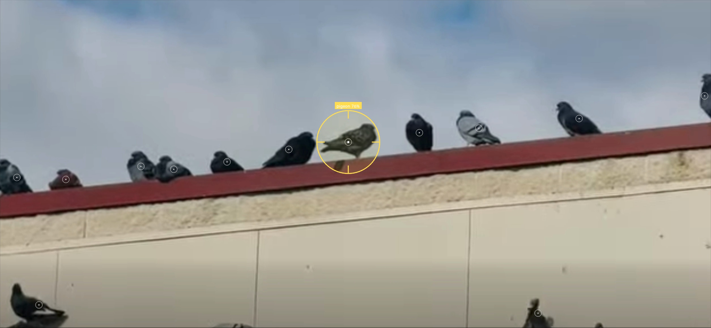
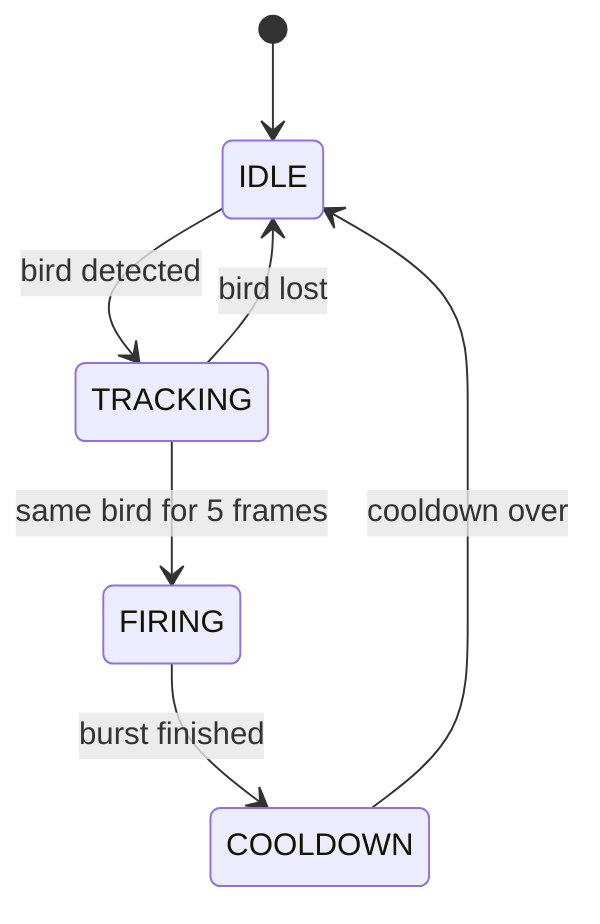
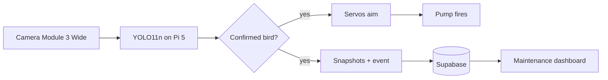

<!-- Header banner -->
<p align="center">
  
</p>

<p align="center">
  
  
  
  
  
  
</p>

<p align="center">
  <b>Spot it. Track it. Splash it.</b>
</p>

---

<!-- Swap this for a real GIF of the turret once it's on the roof -->
<p align="center">
  
</p>

## 🐦 The problem

My apartment complex has a pigeon problem, and my neighbors are tired of it. People walking into the building get hit with poop. Balconies get plastered with white splats. It's gross, and it's been going on for months.

After months of watching this happen, I walked into my leasing office and pitched them a solution, which is this project. Turns out they were actually planning to poison all the pigeons. They told me that if I could make this work, they'd rather go with it. So they agreed, and now I'm building it to save the pigeons from a sudden death and make my apartment a little less gross.

The idea is simple. The turret sees a pigeon, confirms it's actually a pigeon, aims, and gives it a short harmless spray of water. Pigeons hate getting wet, are easily startled, and they learn fast. Nobody gets poisoned, and nobody gets pooped on.

```yaml
project:    Pigeon Patrol
builder:    Sierra Ryan
hardware:   Raspberry Pi 5 + Camera Module 3 Wide + pan/tilt servos + 12V pump
model:      YOLO11n (COCO class 14, "bird")
runs:       fully on device, no cloud inference
reports_to: Supabase (event log + snapshots for building maintenance)
approved:   yes, by my leasing office (instead of poisoning the pigeons)
```

## ⚙️ How it works

Every frame goes through the same loop. The turret only fires after the same bird shows up in 5 frames in a row, so a single bad detection never sets it off.



| Stage | What happens |
|---|---|
| **Detect** | YOLO11n looks for birds in each 1280x720 frame from the wide camera |
| **Track** | Sticks to the bird closest to where it was last frame, and resets if it jumps too far |
| **Confirm** | Needs 5 frames in a row (about 1 second) before it commits |
| **Aim** | Converts the bird's pixel position into pan and tilt servo angles |
| **Fire** | Pump runs for a short burst through a MOSFET on GPIO17 |
| **Log** | Saves a clean and an annotated snapshot, then uploads both to Supabase |



## 🛠️ Built with

<p align="left">
  
  &nbsp;
  
  &nbsp;
  
  &nbsp;
  
  &nbsp;
  
  &nbsp;
  
</p>

### Hardware

| Part | Job |
|---|---|
| Raspberry Pi 5 (8GB) + active cooler | The brain. Runs detection, tracking and control |
| Camera Module 3 Wide | Wide view of the roof with continuous autofocus |
| PCA9685 servo driver (I2C) | Drives the servos with clean PWM |
| 2x DS3225 25kg servos + pan/tilt bracket | Aim the nozzle |
| 12V diaphragm pump + MOSFET module | Water on, water off |
| Buck converter (12V to 6V) | Powers the servos |
| Float switch | Stops the pump when the tank runs dry |
| Kill switch + inline fuse | Because water and electricity |
| Gutted toy water gun | Mostly for looks, honestly |

## 📁 Repo layout

```
pigeon_patrol/
├── detect.py      # main loop: detection, tracking, state machine, logging
├── turret.py      # real servo + pump control
├── uploader.py    # background uploads to Supabase
├── data/          # test videos (not committed)
├── snapshots/     # local shot images (not committed)
└── .env           # Supabase keys, lives only on the Pi (never committed)
```

## 🚀 Running it

```bash
git clone https://github.com/sryanprograms/pigeon_patrol.git
cd pigeon_patrol

# On the Pi, include system packages so picamera2 works
python -m venv --system-site-packages .venv
source .venv/bin/activate
pip install ultralytics opencv-python adafruit-circuitpython-servokit supabase python-dotenv

# Test on a video
python detect.py data/pigeons.mov

# Live camera on the Pi
python detect.py camera
```

To upload events, make a `.env` file on the Pi with `SUPABASE_URL` and `SUPABASE_SECRET_KEY`. Without it the turret still runs and just skips uploading.

## 🗺️ Roadmap

- [x] Bird detection on recorded video
- [x] Live detection on the Pi camera
- [x] Sticky tracking and 5 frame confirmation
- [x] Snapshot logging (clean and annotated)
- [x] Event and snapshot uploads to Supabase
- [ ] Servos and pump wired and bench tested
- [ ] Pixel to angle calibration
- [ ] Safety checks (person detection, firing zone, servo limits)
- [ ] Weatherproof enclosure and roof install
- [ ] Video clips of each spray
- [ ] Maintenance dashboard with daily stats
- [ ] Faster inference (NCNN export)

## 🛡️ Safety

- Water only, short bursts, aimed at birds that are on the roof
- The pump always shuts off when the program stops or crashes
- The turret will not fire if a person is in view (in progress)
- Snapshots go to a private bucket that only signed in building staff can see

## 👋 About me

I'm Sierra, a Data Science student at Arizona State with a concentration in Geospatial AI Systems and I love building computer vision, GIS, and autonomy projects!

<p align="left">
  <a href="https://github.com/sryanprograms"></a>
  <!-- Add your LinkedIn URL below -->
  <a href="https://www.linkedin.com/in/YOUR-LINKEDIN"></a>
</p>

<!-- Footer banner -->
<p align="center">
  
</p>
